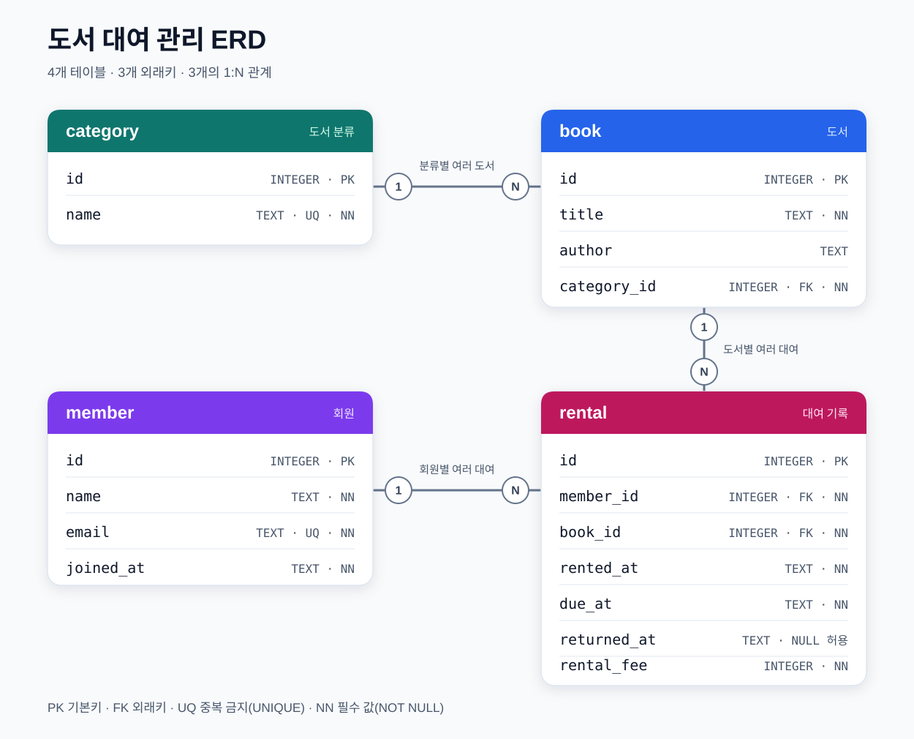

# 도서 대여 관리 SQL 실습

Codyssey B6-1 필수 과제입니다. 로컬 SQLite에서 도서 대여 관리 DB를 만들고, 샘플 데이터를 넣은 뒤 Q01~Q16을 실행했습니다. 핵심 제출물은 `schema.sql`, `seed.sql`, `queries.sql`입니다. 보너스 과제와 웹 기능은 포함하지 않았습니다.

## 실행 환경과 파일

실제 확인한 환경은 macOS(Darwin), Python 3.14.3, SQLite CLI 3.51.0입니다. Python 표준 라이브러리 `sqlite3`의 SQLite 버전은 3.51.2입니다. 별도 패키지 설치는 필요하지 않습니다. `python3 --version`과 `sqlite3 --version`으로 설치 여부를 확인할 수 있습니다. CLI가 없어도 Python 3의 표준 라이브러리로 실행할 수 있습니다.

파일은 현재 프로젝트의 루트 폴더에 둡니다.

```text
schema.sql             4개 테이블과 제약조건
seed.sql               가상 샘플 데이터
queries.sql            Q01~Q16 핵심 SQL
run.py                 새 DB 실행 및 결과 저장 보조 스크립트
validate.py            요구사항 검증 보조 스크립트
practice.sqlite3       실제 실행한 로컬 SQLite DB
erd.svg                4개 테이블과 1:N 관계를 나타낸 ERD 이미지
results/Q01.txt~Q16.txt 각 쿼리의 실제 SQL과 결과
results/validation.txt 실제 검증 결과
README.md              실행 방법과 설계 설명
```

## DB 설계



그림의 `1`은 부모 행 하나, `N`은 연결될 수 있는 자식 행 여러 개를 뜻합니다. `PK`는 기본키, `FK`는 외래키, `UQ`는 중복 금지, `NN`은 필수 값입니다. 자세한 제약조건과 날짜 순서 검사는 `schema.sql`을 참고하세요.

| 테이블 | 역할 | 주요 컬럼 |
| --- | --- | --- |
| `member` | 회원 | `id` PK, `name`, `email`, `joined_at` |
| `category` | 도서 카테고리 | `id` PK, `name` |
| `book` | 도서 | `id` PK, `title`, `author`, `category_id` FK |
| `rental` | 대여 기록 | `id` PK, `member_id` FK, `book_id` FK, `rented_at`, `due_at`, `returned_at`, `rental_fee` |

PK는 한 행을 구별하는 기본 키입니다. FK는 다른 테이블의 PK를 가리키는 외래 키입니다. `category.id` → `book.category_id`, `member.id` → `rental.member_id`, `book.id` → `rental.book_id`가 각각 1:N 관계입니다. 예를 들어 한 회원은 여러 대여 기록을 가질 수 있습니다.

`member.name`, `member.email`, `category.name`, `book.title` 등에 `NOT NULL`을 적용했습니다. `member.email`과 `category.name`에는 `UNIQUE`도 적용했습니다. 날짜는 `YYYY-MM-DD` 형식의 `TEXT`로 저장합니다. `returned_at`이 `NULL`이면 미반납입니다. `rental_fee`는 0 이상의 정수이며, 대여일 이후의 반납 예정일·실제 반납일만 허용합니다.

## 실행과 재실행

프로젝트 루트에서 다음 순서로 실행합니다.

```sh
python3 run.py
python3 validate.py
```

`run.py`는 새 SQLite DB에 외래 키 검사를 켠 뒤 `schema.sql` → `seed.sql` → `queries.sql` 순서로 실행합니다. Q01~Q16의 실제 결과를 `results/Qxx.txt`에 저장하고, 실행을 마친 DB를 `practice.sqlite3`로 둡니다. `validate.py`는 시드 직후 상태와 실행 후 DB를 검증하고 `results/validation.txt`를 만듭니다.

같은 두 명령을 다시 실행하면 새 실습 DB에서 Q01부터 다시 시작합니다. 이때 이 과제의 `practice.sqlite3`와 Q01~Q16 결과 파일을 다시 만듭니다. `run.py`는 SQLite `application_id`가 이 과제의 값인 DB만 교체하며 다른 DB 파일이면 중단합니다. 실습 DB를 별도로 보관하려면 재실행 전에 복사해 두면 됩니다. 파일을 직접 삭제할 필요는 없습니다.

SQL 파일을 SQLite CLI에서 직접 살펴보려면 빈 메모리 DB를 사용할 수 있습니다.

```text
sqlite3 :memory:
sqlite> PRAGMA foreign_keys = ON;
sqlite> .read schema.sql
sqlite> .read seed.sql
sqlite> .headers on
sqlite> .mode column
sqlite> .read queries.sql
sqlite> PRAGMA foreign_key_check;
sqlite> .quit
```

SQLite의 FK 검사는 **연결마다** `PRAGMA foreign_keys = ON`으로 켜야 합니다. 위의 `.read`, `.headers`, `.mode`는 SQLite CLI 명령이며 핵심 SQL 파일에는 넣지 않았습니다. Q14·Q15·Q16이 데이터를 변경하므로 CLI 실습도 새 DB에서 시작합니다.

## Q01~Q16

| 번호 | 범주 | 목적 |
| --- | --- | --- |
| Q01 | 기본 조회 | 2026년에 가입한 회원 조회 |
| Q02 | 기본 조회 | 프로그래밍 카테고리 도서 조회 |
| Q03 | 기본 조회 | 최근 대여 5건 조회 |
| Q04 | 기본 조회 | 미반납 대여 조회 |
| Q05 | 조인 | 도서명과 카테고리명 조회 |
| Q06 | 조인 | 회원별 도서 대여 내역 조회 |
| Q07 | 조인 | 대여 기록이 없는 회원을 포함한 전체 회원 조회 |
| Q08 | 조인 | 대여 기록이 없는 도서를 포함한 전체 도서 조회 |
| Q09 | 집계 | 회원별 대여 건수 조회 |
| Q10 | 집계 | 카테고리별 대여료 합계 조회 |
| Q11 | 집계 | 카테고리별 대여료 평균 조회 |
| Q12 | 집계 | 도서별 대여 횟수 순위 조회 |
| Q13 | 서브쿼리 | 대여 기록이 없는 회원 조회 |
| Q14 | 데이터 수정 | 대여 23번을 반납 완료로 수정 |
| Q15 | 데이터 삭제 | 대여 24번 한 건 삭제 |
| Q16 | 인덱스 | `rental.member_id` 인덱스 생성 |

Q14·Q15에는 변경 전후 조회와 변경된 행 수 확인을 포함했습니다. Q16에는 인덱스 생성 확인을 포함했습니다. 이 확인 명령들은 별도의 핵심 쿼리로 세지 않습니다. 회원별 대여 조회는 `rental.member_id`로 연결하므로 해당 컬럼의 인덱스가 검색할 행을 찾는 데 도움이 됩니다.

## 실제 결과와 확인할 개념

샘플 입력 직후 행 수는 회원 10, 카테고리 10, 도서 16, 대여 24입니다. Q14·Q15 실행 후에는 대여가 23건이며, FK 위반은 0건입니다. 각 쿼리의 SQL·컬럼명·실제 행 데이터는 `results/Q01.txt`부터 `results/Q16.txt`에 있고, 필수 요구사항별 검증값은 `results/validation.txt`에 있습니다.

학습할 때는 `WHERE`로 행을 고르고 `ORDER BY`·`LIMIT`로 순서와 개수를 정하는 방법, `INNER JOIN`과 `LEFT JOIN`의 결과 차이, `COUNT`·`SUM`·`AVG` 및 `GROUP BY`, `NOT EXISTS` 서브쿼리, PK로 범위를 제한한 `UPDATE`·`DELETE`를 직접 확인하면 됩니다. Q09의 `COUNT(r.id)`는 대여가 없는 회원을 0건으로 표시합니다.

SQLite 전용 사용 부분은 각 SQL 파일에 주석으로 표시했습니다. `PRAGMA foreign_keys`는 연결별 FK 검사, `PRAGMA index_list`는 인덱스 확인, `changes()`는 직전 수정·삭제 행 수 확인에 사용합니다. `INTEGER PRIMARY KEY`는 SQLite에서 `rowid`와 연결되며, Q03의 `LIMIT`는 조회 결과를 5행으로 제한합니다. 보조 스크립트의 `PRAGMA application_id`는 재실행할 때 과제 DB를 식별합니다.
